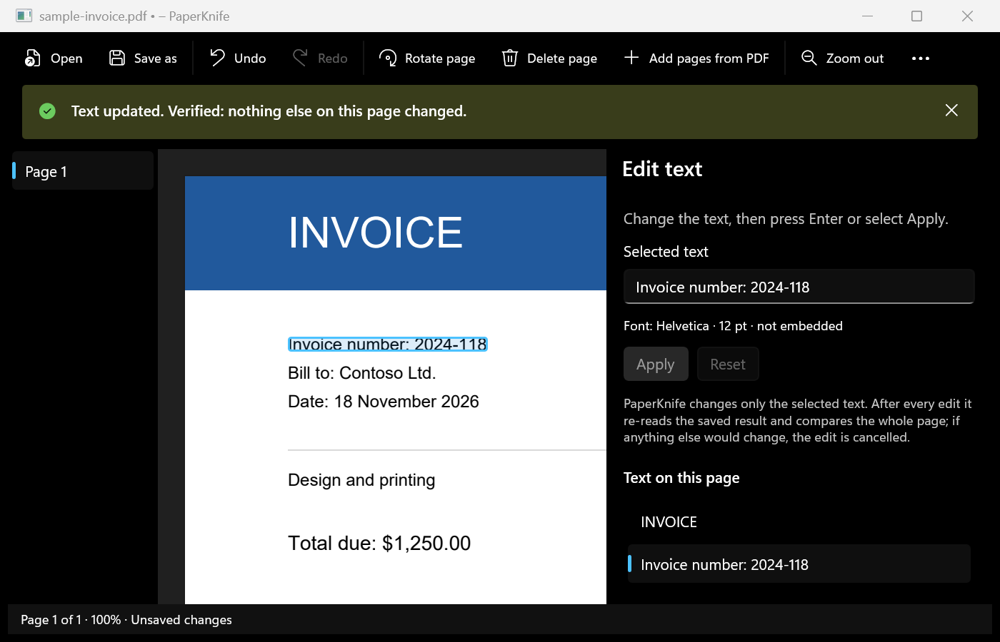
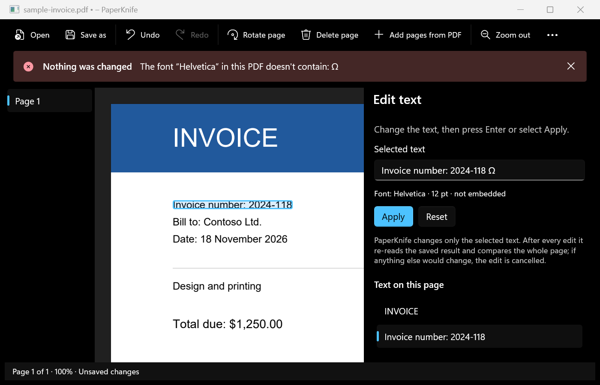

# PaperKnife for Windows

**Edit PDFs on your own computer — honestly.** PaperKnife is a free, open-source, offline PDF
editor. Your documents never leave your device: no uploads, no account, no telemetry.



> **Status: early preview (version 0.1).** The engine and a first editor work, with rough
> edges. Keep a backup of any document you can't afford to lose.

## Download

Get the latest version from the
**[Releases page](https://github.com/shivam098/paperknife-windows/releases/latest)**. PaperKnife
runs on Windows 10 (version 1809) or later and Windows 11, on any 64-bit PC: Intel, AMD or Arm.
Nothing else needs to be installed.

| File | Choose it if |
|---|---|
| `PaperKnife-<version>-setup.exe` | You want PaperKnife in the Start menu and in **Open with** for PDFs. One installer for every 64-bit PC. |
| `PaperKnife-<version>-x64-portable.zip` | You'd rather not install anything, on an Intel or AMD PC: unzip and run `PaperKnife.exe`. |
| `PaperKnife-<version>-arm64-portable.zip` | The same, on an Arm PC (for example Snapdragon). |

- **No administrator rights needed.** The installer installs PaperKnife for your account only.
  To remove it, uninstall it from *Settings > Apps*.
- **"Windows protected your PC"?** Releases aren't code-signed yet, so Microsoft Defender
  SmartScreen warns about them. Select **More info**, then **Run anyway**. If Smart App Control is
  turned on, it may block PaperKnife until releases are signed.
- **Check a download** by comparing `Get-FileHash <file>` with `SHA256SUMS.txt` on the release
  page.
- **Make it your PDF app:** right-click a PDF, choose **Open with > Choose another app**, select
  PaperKnife and **Always**.

## What works today

- Open PDFs (including password-protected ones), browse pages and zoom.
- **Edit existing text in place.** Click a line of text, or pick it from *Text on this page*,
  change it and press Enter. The original font, size, position and color are kept.
- **Every edit is verified.** Before editing, PaperKnife checks that it can rewrite the page
  without changing how it looks, so the edited text keeps its exact style. It then applies the
  change to a copy, saves that copy and opens it again, hides the edited text in both versions
  and compares the rest of the page pixel by pixel, including whatever lies under the text. If
  anything else would change, or the font can't draw a character you typed, the edit is
  cancelled and your document stays exactly as it was.
- Undo and redo, rotate and delete pages, add pages from another PDF.
- Save as a new file. An existing file is replaced in one step and is never left half-written.



## What it refuses to do (for now)

PaperKnife would rather say no than damage your document. Today it can't:

- add characters that the PDF's own font doesn't contain (embedded fonts often contain only the
  letters already used in the document);
- edit scripts that need text shaping (Hindi, Arabic, Thai and others), add line breaks or reflow
  paragraphs;
- edit pages with gradient shading, or pages that PDFium can't rewrite without changing how they
  look, for example because they use letter spacing, print (CMYK) colors or small embedded
  images (see [why](docs/ARCHITECTURE.md#why-every-edit-is-verified));
- edit scanned pages (they contain pictures of text, not text).

All of these are on the [roadmap](docs/ROADMAP.md).

## Privacy

- PaperKnife makes no network requests. It works the same with Wi-Fi turned off.
- Nothing changes on disk until you choose **Save as**; your original stays untouched unless you
  pick it as the destination.
- JavaScript inside PDFs is never run: the bundled PDF engine is built without a JavaScript
  engine.

## Build and run

You need Windows 10 (version 1809) or later, or Windows 11, on x64 or Arm64, and the
[.NET 10 SDK](https://dotnet.microsoft.com/download/dotnet/10.0). Visual Studio is optional.

```powershell
dotnet test --project tests/PaperKnife.Core.Tests/PaperKnife.Core.Tests.csproj   # engine tests
dotnet run --project src/PaperKnife.App                                          # build and launch
dotnet run --project src/PaperKnife.App -- C:\path\to\file.pdf                   # open a file
```

The app builds for your PC's architecture by default; pass `-r win-x64` or `-r win-arm64` to
choose. The first build downloads the Windows App SDK (several hundred megabytes). To build the
installer and portable ZIPs yourself, run `pwsh build/package.ps1 -Version 0.1.0`; see
[CONTRIBUTING.md](CONTRIBUTING.md#releasing).

## Repository layout

| Path | What it is |
|---|---|
| `src/PaperKnife.Core` | The engine: PDFium bindings, documents, verified edits, undo history. No UI code. |
| `src/PaperKnife.App` | The WinUI 3 desktop app. |
| `tests/PaperKnife.Core.Tests` | Engine tests. They generate their own PDFs, so the repo contains no third-party documents. |
| `build/`, `installer/` | Release packaging: the build script and the Inno Setup installer script. |
| `third_party/` | License and notice texts of the components shipped with the app. |
| `docs/` | [Product principles](docs/PRODUCT.md), [roadmap](docs/ROADMAP.md), [architecture](docs/ARCHITECTURE.md), [release notes](docs/releases/). |

## Other platforms

PaperKnife is planned as a separate native app per platform:
[Android](https://github.com/shivam098/paperknife-android),
[iOS](https://github.com/shivam098/paperknife-ios) and
[macOS](https://github.com/shivam098/paperknife-macos). Windows is the lead implementation; the
shared product principles live in [docs/PRODUCT.md](docs/PRODUCT.md).

## Contributing

Contributions are welcome. Please read [CONTRIBUTING.md](CONTRIBUTING.md) first, and report
security issues as described in [SECURITY.md](SECURITY.md).

## License

PaperKnife is licensed under the [Apache License 2.0](LICENSE). It includes PDFium and other
third-party components; see [THIRD_PARTY_NOTICES.md](THIRD_PARTY_NOTICES.md).
