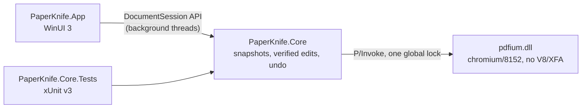

# PaperKnife for Windows — architecture

## Overview



| Project | Responsibility |
|---|---|
| `PaperKnife.Core` | Everything about PDFs. Targets `net10.0`, has no UI dependencies, and keeps all native calls internal. |
| `PaperKnife.App` | WinUI 3 (the WinUI component of Windows App SDK 2.6), unpackaged and self-contained, so the same app folder runs from a build, a ZIP or the installer. Talks only to `DocumentSession`. |
| `PaperKnife.Core.Tests` | Tests that build their PDFs at run time, either through PDFium or as hand-written PDF syntax. |

## The PDF engine

PaperKnife uses [PDFium](https://pdfium.googlesource.com/pdfium/), the engine in Chrome,
through the prebuilt `bblanchon.PDFium.Win32` package (x64 and Arm64). The build has no V8
(JavaScript) or XFA support. We considered MuPDF, which has a capable editing API, but its AGPL
license would force every PaperKnife app to be AGPL and conflicts with app-store distribution.

`Pdfium/PdfiumNative.cs` declares only the functions PaperKnife uses, checked against the
headers in the package. PDFium isn't thread-safe and keeps global state, so every native call in
the process happens while holding `PdfiumLibrary.Sync`. The app calls the engine from background
threads. While a command runs, every control that could start another engine call is disabled,
and the window reads a copy of the session's state taken when the last command finished, so the
UI thread doesn't wait for the engine.

## Documents are immutable snapshots

- `PdfSnapshot` is a complete serialized PDF in memory. Its bytes live on the pinned object heap,
  so PDFium can read them in place for as long as a document loaded from them is open.
- `PdfDocument` is a snapshot loaded into PDFium. Its public members only read; mutating methods
  are internal so that every change goes through `DocumentSession`.
- `DocumentSession` holds the current snapshot, the document loaded from it, and the undo and
  redo stacks, which are also snapshots. The history is limited to about 512 MB; the newest undo
  step is always kept.

Saving writes the current snapshot's bytes, which are exactly the bytes that were verified. The
file is written to a temporary file in the destination folder, flushed and then renamed over the
destination, so an existing file is never left half-written.

## Every edit is a transaction

```mermaid
sequenceDiagram
    participant UI as App
    participant S as DocumentSession
    participant X as Scratch copy
    participant V as Reloaded candidate
    UI->>S: ReplaceText(page, run, text)
    S->>S: Pre-checks (permissions, page content, characters)
    S->>X: Load current snapshot, rewrite the changed objects, move the rest of the run, read it back
    X-->>S: Candidate snapshot (saved without incremental update)
    S->>V: Load candidate
    S->>V: Compare page count, object counts, text, positions and pixels
    alt Everything matches
        S->>S: Commit: candidate becomes current, old snapshot goes to undo
    else Anything differs
        S->>S: Discard the candidate; the document is unchanged
    end
    S-->>UI: EditResult (applied, no change, or rejected with a reason)
```

1. **Pre-checks**, before anything changes:
   - The document's permissions allow changing content (see [Permissions](#permissions)).
   - The page has no content that PDFium can't rewrite (gradient shadings, unknown objects).
   - Trailing whitespace is removed from the new text: it is invisible, and a character the font
     can't draw there would be impossible to detect.
   - The new text has no line breaks, tabs or characters outside the Basic Multilingual Plane,
     and no scripts that need shaping.
   - The font can draw every character that will be written: it has a positive advance width,
     and PDFium returns a glyph outline that differs from the font's "missing glyph" outline
     (for spaces, an empty outline, because a space that draws a shape is the missing-glyph box).
   - **Rewrite check:** the page is rewritten by PDFium with nothing changed (the objects of the
     edited run are only marked as modified) and must render exactly as before. This catches
     styling PDFium can't write back, including on the edited text itself, which step 4 can't
     see because it hides that text.
2. **Apply** the smallest change to a scratch copy (see [Editing a run](#editing-a-run)) and
   read the text back. `FPDFText_SetText` silently turns characters it can't encode into
   character code 0, so the round trip catches anything the pre-checks missed.
3. **Serialize** the scratch copy with `FPDF_SaveAsCopy`.
4. **Verify** by loading the candidate as a new document:
   - the page count is unchanged;
   - the edited page has the same number of objects of each kind as before, minus the text
     objects the edit removed;
   - the changed object contains the new text. If more of the run follows it, it also ends where
     the font's advance widths say it should. This is checked here rather than in memory,
     because saving drops character and word spacing that still applies in memory;
   - every object after it in the run still has its text and moved by exactly the planned
     distance (within 0.01 point), and sticks out of the page no further than before;
   - moving didn't change how the moved objects are clipped. Moving a text object doesn't move
     its clipping path, so text could be cut off at the edge of a clipped area, or text that was
     cut off could appear. On a copy of the original page, the moved objects are moved and
     rendered on their own, then rendered again with their clipping paths moved along with them,
     and both renderings must cover the same pixels. They are drawn on a transparent background
     and compared by alpha, so white text counts too. The saved copy can't serve here: PDFium
     drops a rectangular clipping path when it loads a page in which the path contains its
     object;
   - with the changed and moved objects hidden (`FPDFPageObj_SetIsActive`) in both the original
     and the candidate, the whole page renders the same at 144 dpi, allowing for anti-aliasing
     noise. Hiding the objects, rather than skipping their area, also checks whatever lies under
     or over them.
5. **Commit** or discard. A rejected edit returns a plain-language reason.

Page commands (rotate, delete, move, append) follow the same pattern with checks suited to them.

### Why every edit is verified

When a page changes, PDFium regenerates that page's content stream from its own object model
(`CPDF_PageContentGenerator` in `core/fpdfapi/edit/cpdf_pagecontentgenerator.cpp`). That
regeneration doesn't reproduce everything a PDF can contain:

| PDFium behavior | Effect without verification | What PaperKnife does |
|---|---|---|
| `ProcessPageObject` writes only image, form, path and text objects | Gradient shadings disappear | Refuses to edit such pages up front |
| `ProcessImage` skips inline images | Small embedded images disappear | The rewrite check fails, so the edit is refused |
| `ProcessText` writes font, size, render mode, matrix and kerning, but not character or word spacing (`Tc`, `Tw`); horizontal scaling and rise survive because they are folded into the text matrix | Spaced-out text, including the edited text itself, shifts | The rewrite check fails, so the edit is refused |
| `WriteColorToStream` writes only RGB and gray colors | CMYK, spot and other colors turn black | The rewrite check fails, so the edit is refused |
| `ProcessText` stops for fonts other than Type 1, TrueType and CID fonts (for example Type 3) | That text disappears | The rewrite check fails, so the edit is refused |

The tests include hand-written PDFs with shadings, inline images, character and word spacing and
CMYK colors (on other text and on the edited text itself), and check that each edit is refused.
Milestone M2 replaces whole-page regeneration with surgical edits that keep every other byte of
the page, which will lift these restrictions; verification stays as a safety net.

### Comparing text

Text read back from a PDF can differ from what was written without any visible difference:

- Fonts often share one glyph between several characters. In Arial, the space glyph is also the
  no-break space, so `Invoice 2024` reads back as `Invoice` + U+00A0 + `2024`.
- PDFium reports the gap before the next run on the same line as a generated trailing space.

So comparisons use Unicode NFC normalization (which also maps U+2126 OHM SIGN to Ω), treat all
space separators as spaces, and drop the trailing whitespace PDFium adds when reading. They don't
use NFKC: it would treat visibly different text, such as `m2` and `m²` or `...` and `…`, as the
same. Line breaks and tabs are still significant.

When it reads back an object it changed, PaperKnife also ignores how much whitespace PDFium
reports. PDFium derives spaces from the gaps between glyphs, so it may or may not report a space
at the start or end of an object. Spacing is checked by position instead: the changed object
must end where its advance widths say it should, and everything after it in the run must be
where it was moved.

## Text runs

A *run* is the unit of text PaperKnife selects and edits: usually a line, or a table cell. Many
PDFs draw a line with one text object, but some draw every word or every character as an object
of its own; PDFs that wkhtmltopdf makes from web pages, for example, position each glyph
separately. `TextLayout` groups a page's top-level text objects into runs.

### Grouping text objects into runs

Objects that are consecutive in page order join a run when:

- their characters follow each other in PDFium's text extraction (`FPDFText_*`), and each
  object's characters are contiguous there and all have Unicode values;
- they look the same: font, render mode, size, orientation, fill color (and stroke color when
  outlines are stroked), marked content and clipping path;
- the next object starts on the same baseline (within 0.05 em), at most 1 em after the previous
  one ends and overlapping it by at most 0.5 em. Gaps between words are narrower than 1 em; gaps
  between table cells are usually wider.

The run's text has a space between two objects where PDFium found a gap. Two habits of PDFium's
text extraction need care:

- It skips text objects that draw only spaces, because their bounding box is empty, and reports
  the gap as a generated space. Such *spacer* objects join a run when they sit on the line
  between two objects that can join; each becomes a space in the run's text if it leaves a gap of
  at least half a space. As PDFium doesn't measure them, a spacer is taken to be a normal space
  wide, but no wider than the gap it leaves.
- On sparse pages of one-character objects, it sometimes misjudges the writing direction and
  reports line breaks between characters on one line. Grouping ignores reported line breaks and
  relies on the geometry.

Text nested inside form XObjects isn't editable yet, and it separates the text around it.

### Editing a run

`TextRunEdit` compares the run's old and new text and finds the smallest range of objects whose
characters change. The first of them takes the new text for the whole range
(`FPDFText_SetText`) and the others are removed. Objects before the range are untouched. Objects
after it keep their characters and move along the baseline as a block, by the difference
between where the new text ends and where the old text ended (PDFium lays out new text by
advance widths, without kerning). For example, in a line drawn one character per object,
changing `Dear Customer` to `Dear Reader` writes `Read` into the object that drew `C`, removes
the objects for `ustom` and moves `er` to the left.

- Inserted text joins the object it follows or, after a gap, the object that comes next.
- Deleting part of a line removes objects and moves the rest. Deleting a whole line isn't
  supported yet.
- The run's trailing whitespace stays as it is.
- Where the old text ended is measured from the glyph that was drawn. A font's width for a
  Unicode value (`FPDFFont_GetGlyphWidth`) can belong to another glyph: ligatures, alternate
  glyphs and some encodings map several character codes to one Unicode value. PDFium's loose
  character box is the advance box of the code that was drawn, united with the glyph's ink, and
  a space's tight box is its advance box. Where these show the advance, PaperKnife uses it;
  otherwise the advance ends inside the ink, and the font's width must agree with that. If it
  doesn't, the edit is refused rather than move the rest of the line by a guess.
- Only the run moves. Text beyond it, such as the next table cell, stays where it is; if longer
  text now overlaps it, the edit succeeds with a warning.

## Permissions

PDFs can restrict what readers may do. PaperKnife follows the flags returned by
`FPDF_GetDocPermissions` (ISO 32000-1, table 22):

| Action | Requires |
|---|---|
| Edit text | "Modify contents" |
| Rotate, delete, move or insert pages | "Modify contents", or "assemble" for security handler revision 3 and later (revision 2 has no separate "assemble" flag) |
| Copy pages into another PDF (append, merge, extract) | "Copy" and the page permission above, checked on the source document; otherwise the pages would leave their protection behind |

Saving keeps a protected document's encryption and restrictions.

## Rendering and selection

- Pages render with `FPDF_RenderPageBitmap` into 32-bit BGRA buffers on a white background, with
  annotations, and are shown through a `WriteableBitmap` scaled for the monitor's DPI.
- Clicks map to page coordinates with `FPDF_DeviceToPage`. Among the text runs under the pointer,
  visible text wins over invisible OCR text, then the smallest run, then the topmost.
- A text run is a line or table cell drawn by one or more top-level text objects; see
  [Text runs](#text-runs).

## Security

PDF files are untrusted input. Today PDFium runs inside the app process, without the sandbox it
has in Chrome. Mitigations: the build has no JavaScript or XFA, the app makes no network
requests, and edits never write to disk until the user saves. Moving the engine into a separate,
low-privilege process is on the roadmap.

## Testing

- Unit and scenario tests run with xUnit v3 on Microsoft Testing Platform
  (`dotnet test --project …`).
- Documents are generated by the tests: through PDFium for ordinary text, as hand-written PDF
  syntax for constructs PDFium can't create (inline images, shadings, character spacing,
  kerning), or with the standard RC4 security handler for permission tests.
- Tests cover the refusals for unsupported characters and layout, shadings, inline images,
  character and word spacing, CMYK colors, changes under the edited text and author
  restrictions, and check that a refused change leaves the document unchanged. Refusals not yet
  covered: empty text, unknown page objects and Type 3 fonts.
- CI runs on Windows x64 and Windows on Arm.

## Decisions

| Decision | Why |
|---|---|
| WinUI 3 rather than WPF | Microsoft's recommended UI framework for new desktop apps; native on Arm64; builds with the .NET SDK alone. |
| PDFium rather than MuPDF | Permissive license compatible with Apache-2.0 and app stores; mature rendering. |
| Whole-document snapshots for undo | Exact undo with simple code. Large documents pay in memory and time; incremental history is planned. |
| Unpackaged, self-contained app with an Inno Setup installer | Nothing else to install (.NET and the Windows App SDK runtime are included), installs per user without administrator rights, and one installer serves x64 and Arm64. An MSIX package for the Microsoft Store can come later. |
| The `Microsoft.WindowsAppSDK.WinUI` component rather than the `Microsoft.WindowsAppSDK` meta-package | The meta-package also ships AI and machine-learning runtimes (about 40 MB per architecture) that PaperKnife doesn't use. |
