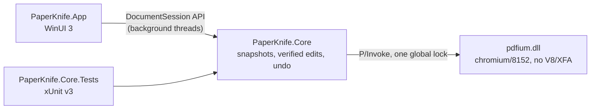

# PaperKnife for Windows — architecture

## Overview



| Project | Responsibility |
|---|---|
| `PaperKnife.Core` | Everything about PDFs. Targets `net10.0`, has no UI dependencies, and keeps all native calls internal. |
| `PaperKnife.App` | WinUI 3 (the WinUI component of Windows App SDK 2.6), unpackaged and self-contained, so the same app folder runs from a build, a ZIP or the installer. Talks only to `DocumentSession`. |
| `PaperKnife.Core.Tests` | Tests that build their PDFs at run time, either through PDFium or as hand-written PDF syntax. |

## The PDF engine

PaperKnife uses [PDFium](https://pdfium.googlesource.com/pdfium/), the engine in Chrome,
through the prebuilt `bblanchon.PDFium.Win32` package (x64 and Arm64). The build has no V8
(JavaScript) or XFA support. We considered MuPDF, which has a capable editing API, but its AGPL
license would force every PaperKnife app to be AGPL and conflicts with app-store distribution.

`Pdfium/PdfiumNative.cs` declares only the functions PaperKnife uses, checked against the
headers in the package. PDFium isn't thread-safe and keeps global state, so every native call in
the process happens while holding `PdfiumLibrary.Sync`. The app calls the engine from background
threads. While a command runs, every control that could start another engine call is disabled,
and the window reads a copy of the session's state taken when the last command finished, so the
UI thread doesn't wait for the engine.

## Documents are immutable snapshots

- `PdfSnapshot` is a complete serialized PDF in memory. Its bytes live on the pinned object heap,
  so PDFium can read them in place for as long as a document loaded from them is open.
- `PdfDocument` is a snapshot loaded into PDFium. Its public members only read; mutating methods
  are internal so that every change goes through `DocumentSession`.
- `DocumentSession` holds the current snapshot, the document loaded from it, and the undo and
  redo stacks, which are also snapshots. The history is limited to about 512 MB; the newest undo
  step is always kept.

Saving writes the current snapshot's bytes, which are exactly the bytes that were verified. The
file is written to a temporary file in the destination folder, flushed and then renamed over the
destination, so an existing file is never left half-written.

## Every edit is a transaction

```mermaid
sequenceDiagram
    participant UI as App
    participant S as DocumentSession
    participant C as Content stream
    participant X as Scratch copy
    participant V as Reloaded candidate
    UI->>S: ReplaceText(page, run, text)
    S->>S: Pre-checks (permissions, characters)
    alt PaperKnife can read the page's content
        S->>C: Rewrite the run's text operations, append an incremental update
        C-->>S: Candidate snapshot
    else Otherwise
        S->>X: Rewrite check, change the objects, PDFium regenerates the page
        X-->>S: Candidate snapshot (saved without incremental update)
    end
    S->>V: Load candidate
    S->>V: Compare page count, object counts, text, positions and pixels
    alt Everything matches
        S->>S: Commit: candidate becomes current, old snapshot goes to undo
    else Anything differs
        S->>S: Discard the candidate; the document is unchanged
    end
    S-->>UI: EditResult (applied, no change, or rejected with a reason)
```

1. **Pre-checks**, before anything changes:
   - The document's permissions allow changing content (see [Permissions](#permissions)).
   - Trailing whitespace is removed from the new text: it is invisible, and a character the font
     can't draw there would be impossible to detect.
   - The new text has no line breaks, tabs or characters outside the Basic Multilingual Plane,
     and no scripts that need shaping.
   - The font can draw every character that will be written: it has a positive advance width,
     and PDFium returns a glyph outline that differs from the font's "missing glyph" outline
     (for spaces, an empty outline, because a space that draws a shape is the missing-glyph box).
     PDFium can't outline the glyphs of Type 3 fonts, which store each glyph as a drawing; for
     those, the character must have a glyph procedure. In the content stream, a space the font
     can't draw becomes a gap, and a TeX font that lacks a letter may be completed (see
     [Spaces, kerning and TeX fonts](#spaces-kerning-and-tex-fonts)).
2. **Apply** the smallest change (see [Editing a run](#editing-a-run)), in one of two ways:
   - **In the content stream**, whenever PaperKnife can read the page's content with certainty
     (see [Editing the content stream](#editing-the-content-stream)). Only the run's text
     operations change, and the result is appended to the file as an incremental update.
   - **By PDFium rewriting the page** otherwise, for example in encrypted files. PaperKnife first
     refuses pages with content PDFium can't write back (gradient shadings, unknown objects) and
     runs the **rewrite check**: the page is rewritten by PDFium with nothing changed (the
     objects of the edited run are only marked as modified) and must render exactly as before,
     and every text object must keep its matrix and bounds. This catches styling PDFium can't
     write back, including on the edited text itself, which step 3 can't see because it hides
     that text, and on invisible text (for example the text layer of a scanned page), whose
     letter spacing the rendering can't show. Deleting a whole line skips it: nothing of the
     deleted text remains, and the checks after the change cover the rest of the page. The change
     is then applied to a scratch copy and the text read back: `FPDFText_SetText` silently turns
     characters it can't encode into character code 0. The scratch copy is serialized with
     `FPDF_SaveAsCopy`.
3. **Verify** by loading the candidate as a new document:
   - the page count is unchanged;
   - the edited page has the same number of objects of each kind as before, minus the text
     objects the edit removed;
   - the changed object contains the new text. If more of the run follows it, it also ends where
     the font's advance widths say it should. This is checked on the saved candidate rather than
     in memory, because PDFium's rewrite drops character and word spacing that still applies in
     memory;
   - every object after it in the run still has its text and moved by exactly the planned
     distance (within 0.01 point), and sticks out of the page no further than before;
   - moving didn't change how the moved objects are clipped. Moving a text object doesn't move
     its clipping path, so text could be cut off at the edge of a clipped area, or text that was
     cut off could appear. On a copy of the original page, the moved objects are moved and
     rendered on their own, then rendered again with their clipping paths moved along with them,
     and both renderings must cover the same pixels. They are drawn on a transparent background
     and compared by alpha, so white text counts too. The saved copy can't serve here: PDFium
     drops a rectangular clipping path when it loads a page in which the path contains its
     object;
   - with the changed and moved objects hidden (`FPDFPageObj_SetIsActive`) in both the original
     and the candidate, the whole page renders the same at 144 dpi, allowing for anti-aliasing
     noise. Hiding the objects, rather than skipping their area, also checks whatever lies under
     or over them;
   - when a whole line was deleted, every other text object keeps its matrix, bounds, rendering
     mode and text, which also covers invisible text (see [Editing a run](#editing-a-run)).
4. **Commit** or discard. A rejected edit returns a plain-language reason.

Page commands (rotate, delete, move, append) follow the same pattern with checks suited to them.

### Why every edit is verified

When PDFium rewrites a page, it regenerates that page's content stream from its own object model
(`CPDF_PageContentGenerator` in `core/fpdfapi/edit/cpdf_pagecontentgenerator.cpp`). That
regeneration doesn't reproduce everything a PDF can contain. PaperKnife avoids it by editing the
content stream itself whenever it can, so this matters only for the remaining pages, for example
in encrypted files:

| PDFium behavior | Effect without verification | What PaperKnife does |
|---|---|---|
| `ProcessPageObject` writes only image, form, path and text objects | Gradient shadings disappear | Refuses to edit such pages up front |
| `ProcessImage` skips inline images | Small embedded images disappear | The rewrite check fails, so the edit is refused |
| `ProcessText` writes font, size, render mode, matrix and kerning, but not character or word spacing (`Tc`, `Tw`); horizontal scaling and rise survive because they are folded into the text matrix | Spaced-out text, including the edited text itself, shifts | The rewrite check fails, so the edit is refused |
| `WriteColorToStream` writes only RGB and gray colors | CMYK, spot and other colors turn black | The rewrite check fails, so the edit is refused |
| `ProcessText` stops for fonts other than Type 1, TrueType and CID fonts (for example Type 3) | That text disappears | The rewrite check fails, so the edit is refused |

The tests include hand-written PDFs with shadings, inline images, character and word spacing,
CMYK colors (on other text and on the edited text itself) and Type 3 fonts, and check both that
PDFium's rewrite refuses each edit and that editing the content stream makes it while keeping
that content.

### Comparing text

Text read back from a PDF can differ from what was written without any visible difference:

- Fonts often share one glyph between several characters. In Arial, the space glyph is also the
  no-break space, so `Invoice 2024` reads back as `Invoice` + U+00A0 + `2024`.
- PDFium reports the gap before the next run on the same line as a generated trailing space.

So comparisons use Unicode NFC normalization (which also maps U+2126 OHM SIGN to Ω), treat all
space separators as spaces, and drop the trailing whitespace PDFium adds when reading. They don't
use NFKC: it would treat visibly different text, such as `m2` and `m²` or `...` and `…`, as the
same. Line breaks and tabs are still significant.

When it reads back an object it changed, PaperKnife also ignores how much whitespace PDFium
reports. PDFium derives spaces from the gaps between glyphs, so it may or may not report a space
at the start or end of an object. Spacing is checked by position instead: the changed object
must end where its advance widths say it should, and everything after it in the run must be
where it was moved.

## Text runs

A *run* is the unit of text PaperKnife selects and edits: usually a line, or a table cell. Many
PDFs draw a line with one text object, but some draw every word or every character as an object
of its own; PDFs that wkhtmltopdf makes from web pages, for example, position each glyph
separately. `TextLayout` groups a page's top-level text objects into runs.

### Grouping text objects into runs

Objects that are consecutive in page order join a run when:

- their characters follow each other in PDFium's text extraction (`FPDFText_*`), and each
  object's characters are contiguous there and all have Unicode values;
- they look the same: font, render mode, size, orientation, fill color (and stroke color when
  outlines are stroked), marked content and clipping path;
- the next object starts on the same baseline (within 0.05 em), at most 1 em after the previous
  one ends and overlapping it by at most 0.5 em. Gaps between words are narrower than 1 em; gaps
  between table cells are usually wider.

The run's text has a space between two objects where PDFium found a gap. Two habits of PDFium's
text extraction need care:

- It skips text objects that draw only spaces, because their bounding box is empty, and reports
  the gap as a generated space. Such *spacer* objects join a run when they sit on the line
  between two objects that can join; each becomes a space in the run's text if it leaves a gap of
  at least half a space. As PDFium doesn't measure them, a spacer is taken to be a normal space
  wide, but no wider than the gap it leaves.
- On sparse pages of one-character objects, it sometimes misjudges the writing direction and
  reports line breaks between characters on one line. Grouping ignores reported line breaks and
  relies on the geometry.

Text nested inside form XObjects isn't editable yet, and it separates the text around it.

### Editing a run

`TextRunEdit` compares the run's old and new text and finds the smallest range of objects whose
characters change. The first of them takes the new text for the whole range and the others are
removed. Objects before the range are untouched. Objects after it keep their characters and move
along the baseline as a block, by the difference between where the new text ends and where the
old text ended. For example, in a line drawn one character per object, changing
`Dear Customer` to `Dear Reader` writes `Read` into the object that drew `C`, removes the
objects for `ustom` and moves `er` to the left.

- Inserted text joins the object it follows or, after a gap, the object that comes next.
- Deleting part of a line removes objects and moves the rest. Deleting a whole line (empty new
  text) removes every object of the run, spaces at its end included, and moves nothing; in the
  content stream it needs no encoding, so it works in fonts PaperKnife can't write text in. As
  nothing is drawn in its place, verification also requires every other text object on the page
  to keep its matrix, bounds (which show letter and word spacing), rendering mode and text,
  which covers invisible text (for example from OCR) that the page comparison can't see. Text
  is compared as a reader sees it, because PDFium reads an object in the context of its
  neighbours: a hyphen or soft hyphen ending a line reads as U+0002 only while the next line
  follows, and a
  copy drawn over other text, as for fake bold, reads as nothing until the copy above it is
  deleted (so such text is deleted one copy at a time).
- The run's trailing whitespace stays as it is.
- In the content stream, both ends are computed from the character codes, the font's widths and
  the text's own character and word spacing. When PDFium rewrites the page, it lays out the new
  text by advance widths, without kerning or spacing, and where the old text ended is measured
  from the glyph that was drawn: a font's width for a Unicode value (`FPDFFont_GetGlyphWidth`)
  can belong to another glyph, because ligatures, alternate glyphs and some encodings map several
  character codes to one Unicode value. PDFium's loose character box is the advance box of the
  code that was drawn, united with the glyph's ink, and a space's tight box is its advance box.
  Where these show the advance, PaperKnife uses it; otherwise the advance ends inside the ink,
  and the font's width must agree with that. If it doesn't, the edit is refused rather than move
  the rest of the line by a guess.
- Only the run moves. Text beyond it, such as the next table cell, stays where it is; if longer
  text now overlaps it, the edit succeeds with a warning.

## Editing the content stream

PDFium can't write back everything a page contains (see
[Why every edit is verified](#why-every-edit-is-verified)), so PaperKnife makes text edits in the
page's content stream itself whenever it can read the file with certainty. The code is in
`Syntax/` (reading and appending to PDF files) and `Content/` (content streams and fonts), and
`Editing/ContentTextEdit.cs` puts them together.

1. **Read the file.** `PdfFile` reads cross-reference tables and streams (including PNG
   predictors), object streams, chains of incremental updates and the page tree with inherited
   resources. It refuses anything it doesn't fully understand, such as encryption, damaged
   cross-reference data or a stream whose `/Length` is wrong, rather than repair it the way PDFium
   does. Those files are left to PDFium's page rewrite.
2. **Read the content.** The page's content streams are decoded (Flate, LZW, ASCIIHex, ASCII85
   and RunLength) and split into operations, skipping inline image data. `TextShowSimulator`
   follows the graphics and text state the way PDFium's content parser does
   (`core/fpdfapi/page/cpdf_streamcontentparser.cpp`): which `Tj`, `TJ`, `'` and `"` operations
   create text objects, and where each starts. It reads glyph widths as PDFium does: whole
   numbers from `/Widths`, Type 3 widths scaled by the font matrix and rounded, `/W` for CID
   fonts, and PDFium's own metrics for the standard 14 fonts. A page qualifies only if it creates
   exactly as many text objects as PDFium reports, and no other page draws its content streams.
3. **Find the operations.** The n-th text object PDFium reports is the n-th operation that creates
   one. An edit changes only the `BT … ET` blocks holding the edited and moved operations. Every
   text-showing operation in those blocks must start where PDFium places its object (within
   0.01 point, with the same matrix). Blocks that change the graphics state (`q`, `Q`, `cm`) or
   text inside `/ActualText` marked content are left to PDFium.
4. **Encode the new text** with the font's own character codes, found through its ToUnicode map,
   or its encoding and glyph names (see [Spaces, kerning and TeX fonts](#spaces-kerning-and-tex-fonts)).
   Characters the font lacks are refused, as before.
5. **Rewrite the blocks.** Each affected block gets an explicit `Tm` before every text-showing
   operation, so no position depends on another operation's width. The edited operation shows the
   new codes, removed ones are left out, and the rest of the run is shifted along the baseline.
   Everything else in the block, such as fonts, colors, spacing and marked content, is copied byte
   for byte; `TD` keeps its effect on the leading through an explicit `TL`, and `"` keeps its word
   and character spacing. Bytes outside these blocks don't change.
6. **Append an update.** The new content becomes a new version of the page's content stream,
   appended to the file with a cross-reference section of the same kind as the file's last one
   (ISO 32000-1, 7.5.6). Every byte of the original file stays where it was.
7. **Verify** the candidate like any other edit.

Because the rest of the page is never regenerated, letter and word spacing, print colors, inline
images, shadings and Type 3 fonts survive, both elsewhere on the page and on the edited text
itself, so the rewrite check isn't needed. Each edit appends the page's whole content again,
compressed: a few kilobytes for a typical page, more for pages with a lot of vector graphics.
PaperKnife's reader also caps what it decodes (64 MB per page) and the work it spends on a font's
width and character maps, and it refuses object streams nested in object streams, as PDFium
does. Beyond those limits it treats the data as unknown and leaves the edit to PDFium, or uses
PDFium's own glyph widths. It reads each font, character map and font program once, however
many names, fonts or pages refer to it, and keeps it only as long as the pages read with it
(the last 16 viewed); of a Type 1 program it reads only the cleartext part it needs. Fonts
share their character maps rather than copying them, and the reverse lookup from text to codes
is built only for the fonts an edit uses.

### Spaces, kerning and TeX fonts

TeX sets text differently from word processors, and PDFs made with LaTeX are common (résumés,
papers). `Editing/GlyphPlanner.cs` and `Fonts/` handle what that takes.

- **Kept text keeps its spacing.** The glyphs of the edited operations are matched to the text
  PDFium reads for them, which has a space wherever PDFium reads a `TJ` adjustment as one (in
  `cpdf_textpage.cpp`: when the gap is at least half the font's space, or, without a usable space
  glyph, a fraction of the next glyph's width) and ligatures (U+FB00 to U+FB06) as their letters.
  The old and new text are then aligned (a longest common subsequence), and text the edit keeps
  keeps its codes, its kerning and its gaps, so only what changed looks different. If the glyphs
  don't match what PDFium reads, nothing is kept and the new text is encoded afresh.
- **Codes are read as PDFium reads them.** For a Type 1 font, PDFium starts from StandardEncoding
  when the font is nonsymbolic, and from the encoding built into the embedded program when it
  is symbolic, as TeX's fonts are (`cpdf_simplefont.cpp`, `cpdf_type1font.cpp`); it ignores an
  `/Encoding` of `/StandardEncoding`. PaperKnife does the same, reading the built-in encoding
  from the program's cleartext part, so in PDFs without a ToUnicode map TeX's ligatures, dashes
  and quotes are read correctly.
- **Spaces become gaps when the font has no space.** TeX fonts have no space glyph: TeX leaves a
  gap between words, which PDFium reads as a space. When the font can't draw a space (PDFium
  finds no space glyph, or a Type 3 font has no glyph procedure for it), a new space becomes a
  `TJ` adjustment: the gap it replaces, or else the median gap PDFium reads as a space in this
  font on the page, or else a third of an em (TeX's usual word space). A gap is widened, if
  needed, to 1.25 times PDFium's threshold for the next glyph, so the space still reads back.
  Only U+0020 and U+00A0 become gaps; other spaces need a glyph.
- **New letters come from a complete copy of the font.** pdfTeX embeds only the glyphs a
  document uses, so an edit often needs a letter the PDF lacks. PaperKnife ships the Type 1
  Computer Modern fonts of the AMS (`third_party/amsfonts`, SIL Open Font License), the versions
  TeX distributions embed. When a subset of one of them lacks a letter, `FontCompletion` adds a
  font of its own to the edited page: the whole, unmodified program, with the PDF font's
  encoding, character map and widths (and the glyphs' own widths for codes that had none, or a
  width of 0 for a glyph the subset leaves out, as some tools write). Only
  the edited text operation selects it (`/PK… size Tf`, then the PDF's font again), so the PDF's
  own font and everything drawn with it, on every page, stay exactly as they were. The page
  gets a new version of its dictionary with resources of its own, so pages that share or
  inherit resources don't change. A later edit reuses a copy on the page only if it is the
  same in every respect: program, encoding, character map, flags and widths. Line grouping
  treats two embedded fonts with the same name as one typeface, so the edited text stays in its
  line. The copy takes the next three object numbers; a file whose numbers already reach
  PDFium's limit (about 25 million, `kMaxObjectNumber` in `cpdf_parser.h`) is refused.
- **The copy must match the subset.** So that letters an edit keeps look the same, `Type1Font`
  decrypts both programs and requires the subset's font matrix, paint type, glyph encryption,
  hinting values and encoding entries, and every glyph program it has, to be identical in
  PaperKnife's font. `CharStringAnalyzer` runs each glyph program (Type 1 programs have no
  branches) to find the subroutines it calls, directly or through others, including hint
  replacement as FreeType's `t1decode.c` runs it; each of those must be identical too, since
  subsetters replace subroutines nothing calls by stubs. The reader refuses anything unusual (a
  key given twice, a glyph or subroutine defined twice, an unexpected token among the glyphs,
  multiple master fonts) rather than guess how a renderer reads it, runs in a single pass, and
  caps what it reads (256 KB of cleartext, 4 MB in all, a step budget for the analysis).
- **Only where viewers agree.** A copy is made only for symbolic fonts whose `/Encoding` is
  absent or lists only `/Differences`: there, PDFium and the PDF specification agree that each
  code selects the glyph the program's own encoding (or `/Differences`) names. After the edit,
  the saved copy is opened: PDFium must draw the edited text with the embedded copy (for a font
  it can't load it substitutes one of its own, which may draw every letter), and every new
  letter must have a glyph in it. The edit reports the copy; the file grows by the font's size
  (about 30 KB).
- Limits: only these Type 1 fonts can be copied, not Latin Modern or the T1-encoded CM-Super
  fonts, nor fonts in other formats.

## Permissions

PDFs can restrict what readers may do. PaperKnife follows the flags returned by
`FPDF_GetDocPermissions` (ISO 32000-1, table 22):

| Action | Requires |
|---|---|
| Edit text | "Modify contents" |
| Rotate, delete, move or insert pages | "Modify contents", or "assemble" for security handler revision 3 and later (revision 2 has no separate "assemble" flag) |
| Copy pages into another PDF (append, merge, extract) | "Copy" and the page permission above, checked on the source document; otherwise the pages would leave their protection behind |

Saving keeps a protected document's encryption and restrictions.

## Rendering and selection

- Pages render with `FPDF_RenderPageBitmap` into 32-bit BGRA buffers on a white background, with
  annotations, and are shown through a `WriteableBitmap` scaled for the monitor's DPI.
- Clicks map to page coordinates with `FPDF_DeviceToPage`. Among the text runs under the pointer,
  visible text wins over invisible OCR text, then the smallest run, then the topmost.
- A text run is a line or table cell drawn by one or more top-level text objects; see
  [Text runs](#text-runs).

## Security

PDF files are untrusted input. Today PDFium runs inside the app process, without the sandbox it
has in Chrome. Mitigations: the build has no JavaScript or XFA, the app makes no network
requests, and edits never write to disk until the user saves. Moving the engine into a separate,
low-privilege process is on the roadmap.

## Testing

- Unit and scenario tests run with xUnit v3 on Microsoft Testing Platform
  (`dotnet test --project …`).
- Documents are generated by the tests: through PDFium for ordinary text, as hand-written PDF
  syntax for constructs PDFium can't create (inline images, shadings, character spacing,
  kerning, Type 3 fonts, object and cross-reference streams), or with the standard RC4 security
  handler for permission tests.
- Tests cover the refusals for unsupported characters and layout, shadings, inline images,
  character and word spacing, CMYK colors, Type 3 fonts, changes under the edited text and author
  restrictions when PDFium rewrites the page, and check that a refused change leaves the document
  unchanged. Refusals not yet covered: unknown page objects.
- Content edits are tested on the same constructs and also on object and cross-reference
  streams, pages drawn by several content streams or sharing one with another page, line
  operators (`'`, `"`, `TD`, `TL`), and text placed right after other text. They must keep every
  byte of the original file and the edited text's own color and spacing. Kerning and gaps kept
  from the old text, and spaces drawn as gaps, are checked in the written content.
- Deleting whole lines is tested in the content stream and with PDFium's page rewrite, for a
  line drawn letter by letter, a line shown with `'` among other lines, invisible text placed
  right after the deleted text, text in a font PaperKnife can't write in (a predefined CJK
  CMap), the line after a hyphenated one (with a hyphen or a soft hyphen) and fake bold text,
  followed by undo; and, with PDFium's page rewrite, text whose own letter spacing or print color
  it can't write back. Edits and deletions that PDFium's rewrite would re-space invisible text
  with are refused.
- TeX fonts are tested with a subset of CMR10 cut from the bundled copy at run time: spaces,
  drawing new letters with a copy of the font (the PDF's font untouched, the copy reused, the
  line kept together, widths for letters the PDF gives a width of 0, object numbers up to
  PDFium's limit), ligatures and kerning without a ToUnicode map, and refusing subsets that
  differ from PaperKnife's font or are crafted to be read differently (a changed glyph, a stray
  token, a glyph defined twice, a stubbed subroutine a glyph calls), nonsymbolic fonts, and a
  program full of junk, which must be read quickly, as must a page that gives one font a
  thousand names.
- Memory tests, which run on their own, page through documents whose fonts have large character
  maps: shared by every page's font, one copy must stay in memory; one per page, only those of
  the last pages viewed.
- CI runs on Windows x64 and Windows on Arm.

## Decisions

| Decision | Why |
|---|---|
| WinUI 3 rather than WPF | Microsoft's recommended UI framework for new desktop apps; native on Arm64; builds with the .NET SDK alone. |
| PDFium rather than MuPDF | Permissive license compatible with Apache-2.0 and app stores; mature rendering. |
| PaperKnife's own PDF reader and incremental writer for text edits, rather than a PDF library | An edit changes only the affected text operations and appends an update, so every other byte of the file survives. A reader that refuses anything uncertain stays small and predictable, and PDFium's page rewrite remains for the files it refuses. |
| New letters in TeX fonts from a complete copy of the identical font, used only by the edited text, rather than replacing the PDF's font or substituting a similar one | The new letters are the same design as the rest of the text, and as the PDF's own font is never changed, nothing else in the document can change, whatever the font contains. Other fonts still need a fallback with the user's consent (roadmap M2). |
| Whole-document snapshots for undo | Exact undo with simple code. Large documents pay in memory and time; incremental history is planned. |
| Unpackaged, self-contained app with an Inno Setup installer | Nothing else to install (.NET and the Windows App SDK runtime are included), installs per user without administrator rights, and one installer serves x64 and Arm64. An MSIX package for the Microsoft Store can come later. |
| The `Microsoft.WindowsAppSDK.WinUI` component rather than the `Microsoft.WindowsAppSDK` meta-package | The meta-package also ships AI and machine-learning runtimes (about 40 MB per architecture) that PaperKnife doesn't use. |
